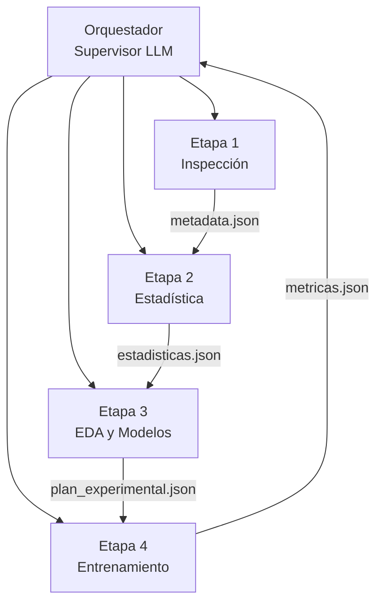

# 🤖 Pipeline Multiagente de Ciencia de Datos

Sistema multiagente que resuelve una problemática de ciencia de datos de forma autónoma: los agentes LLM **deciden** la metodología y el código Python **ejecuta, valida y registra** cada decisión.

---

## 📋 Objetivo

Construir un flujo de trabajo reproducible donde varios agentes especializados colaboran para inspeccionar un dataset, limpiarlo, analizarlo, diseñar una estrategia de modelado y entrenar/evaluar modelos, bajo la supervisión de un orquestador que valida contratos y detecta errores.

Principios rectores:
- **Autonomía con validación:** el LLM decide, pero el sistema verifica que la decisión sea legal y ejecutable.
- **Transparencia total:** se registra todo, incluidas desviaciones, *fallbacks* y cifras que el LLM citó sin respaldo en los datos.
- **Comunicación por archivos:** JSON para metadatos, CSV para datos, Markdown para informes. Cada etapa es independiente y reproducible.

---

## 🏗️ Arquitectura y Agentes



### Los agentes

| Agente | Archivo | Rol | Salidas principales |
|--------|---------|-----|---------------------|
| **Etapa 1** | `etapa1_inspeccion.py` | Analiza el dataset y **propone** (no modifica). Define variable objetivo, tarea de ML y propuestas de limpieza/ruido. | `metadata.json`, `reports/reporte_inicial.md` |
| **Etapa 2** | `etapa2_estadistica.py` | **Ejecuta** la limpieza y el ruido propuestos, calcula estadísticas e interpreta. | `dataset_experimental.csv`, `registro_limpieza.json`, `registro_ruido.json`, `estadisticas.json`, `reports/reporte_estadistico.md` |
| **Etapa 3** | `etapa3_eda_modelos.py` | EDA profundo, línea base y **diseño de la estrategia experimental** (transformación, encoding, modelos, métricas). | `propuesta_modelos.json`, `plan_experimental.json`, `reports/reporte_eda.md` |
| **Etapa 4** | `etapa4_entrenamiento.py` | **Entrena y evalúa** los modelos del plan, compara contra la línea base e interpreta resultados. | `metricas.json`, `comparacion_modelos.csv`, `reports/reporte_resultados.md`, `models/*.joblib` |
| **Orquestador** | `orquest.ipynb` | Coordina las 4 etapas, valida contratos y decide avanzar/reintentar/corregir/detener. | `orquestador_log.json` |

### Archivos de soporte

- **`comun.py`** — Utilidades compartidas: cliente LLM, validación de JSON, verificador de cifras (anti-alucinaciones), bloques de prompt reutilizables.
- **`data/`** — Contiene el dataset original (`data.csv`) y todos los artefactos generados (`reports/`, `plots/`, `models/`).

### Modelos LLM (Ollama)

| Uso | Modelo | Etapas |
|-----|--------|--------|
| Rápido | `qwen2.5:7b` | Etapa 1, Etapa 2 |
| Razonamiento | `qwen3.5:9b` | Orquestador, Etapa 3, Etapa 4 |

> Los modelos son configurables vía `--modelo` en cada etapa o en las constantes
> `MODEL_FAST` / `MODEL_SMART` del orquestador.

---

## 🛠️ Entorno y Instalación

### Requisitos

- **SO:** Windows 11 (probado) / Linux / macOS
- **Python:** 3.10 o superior
- **Ollama:** instalado y corriendo localmente

### 1. Crear y activar el entorno virtual

```powershell
# Crear el entorno
python -m venv venv

# Activar (PowerShell)
.\venv\Scripts\Activate.ps1

# Activar (CMD)
.\venv\Scripts\activate.bat

# Activar (Git Bash / Linux / macOS)
source venv/Scripts/activate
```

### 2. Instalar dependencias

```powershell
pip install -r requirements.txt
```

### 3. Descargar los modelos en Ollama

```powershell
ollama pull qwen2.5:7b
ollama pull qwen3.5:9b
```

Verifica que Ollama está activo:

```powershell
ollama list
```

### 4. Colocar el dataset

Sitúa el dataset original en `data/data.csv` (1198 filas × 9 columnas). El
archivo proviene del repositorio
[ticketmaster-price-ml](https://github.com/ethanjaredlee/ticketmaster-price-ml)
bajo licencia **MIT**.

> ⚠️ **No sobrescribas `data/data.csv`**: es la fuente original. Todas las
> etapas leen de él y generan sus salidas en archivos aparte.

---
## 📜 Licencia y Atribución

### Dataset

Los datos utilizados en este proyecto provienen del repositorio
[ticketmaster-price-ml](https://github.com/ethanjaredlee/ticketmaster-price-ml)
por **ethanjaredlee**, publicado bajo la [Licencia MIT](data/LICENSE-DATASET).

--- 

## ▶️ Ejecución

### Ejecución individual de cada etapa

Cada etapa puede correrse por separado (debe respetarse el orden, pues cada una lee los artefactos de la anterior):

```powershell
python etapa1_inspeccion.py
python etapa2_estadistica.py
python etapa3_eda_modelos.py
python etapa4_entrenamiento.py
```

Con opciones:

```powershell
# Elegir un modelo concreto
python etapa3_eda_modelos.py --modelo qwen3.5:9b

# Inyectar observaciones de revisión (ver sección --revision)
python etapa3_eda_modelos.py --revision data/revision_etapa3.json
```

### Ejecución con el orquestador

El orquestador es un notebook que coordina las 4 etapas, valida contratos y registra las decisiones del supervisor:

```powershell
jupyter notebook orquest.ipynb
```

Abre el notebook y ejecuta todas las celdas en orden. El orquestador:
1. Ejecuta cada etapa como subproceso independiente.
2. Valida que se generen las salidas y los campos JSON requeridos.
3. Consulta al supervisor LLM, que decide la siguiente acción
   (`RUN_NEXT_STAGE`, `REQUEST_CORRECTION`, `RETRY_STAGE`, `STOP_SUCCESS`,
   `STOP_FAILURE`, `REQUEST_HUMAN_REVIEW`).
4. Registra todo en `data/orquestador_log.json`.

> Máximo de reintentos por etapa: `MAX_RETRIES_PER_STAGE = 2`. Superado ese
> límite, el orquestador se detiene y solicita intervención humana.

---

## 🔁 Correcciones manuales con `--revision`

Cada etapa acepta el argumento `--revision <ruta_a_json>` para que un revisor humano inyecte observaciones sobre un intento anterior. El LLM las lee, las contrasta con los datos y decide cómo aplicarlas (sin que se le imponga la solución).

### Formato del archivo de revisión

Crea un JSON con la clave `instrucciones_para_reintento`:

```json
{
  "instrucciones_para_reintento": "En la corrida anterior se usó encoding one_hot, lo que generó 581 features para 936 filas de entrenamiento y todos los modelos obtuvieron R² negativo en test (sobreajuste por dimensionalidad). Reconsidera la estrategia de preprocesamiento para las columnas de alta cardinalidad (city, venue, artist) y la relación entre el número de features resultante y el tamaño de la muestra."
}
```

### Flujo de uso

```powershell
# 1. Crear el archivo de revisión
#    data/revision_etapa3.json  (con el contenido de arriba)

# 2. Re-ejecutar la etapa con las observaciones
python etapa3_eda_modelos.py --revision data/revision_etapa3.json

# 3. Continuar con la etapa siguiente
python etapa4_entrenamiento.py
```

El texto de la revisión se añade al prompt del agente como
*"OBSERVACIONES DE REVISIÓN SOBRE UN INTENTO ANTERIOR"*, de modo que el agente las considera pero mantiene su autonomía para verificarlas contra los datos.

---

## 🔄 Replicabilidad

El pipeline está diseñado para ser reproducible de punta a punta:

| Mecanismo | Detalle |
|-----------|---------|
| **Semilla global** | `SEMILLA_GLOBAL = 42` en `comun.py`. Controla el ruido artificial y el muestreo del LLM (`seed` de Ollama). |
| **Ruido determinista** | El ruido gaussiano usa `np.random.default_rng(42)`, por lo que las celdas perturbadas son siempre las mismas. |
| **Dependencias fijadas** | `requirements.txt` con versiones mínimas. |
| **Dataset original intacto** | `data/data.csv` nunca se sobrescribe; las etapas generan artefactos nuevos. |
| **Artefactos regenerables** | Borrar `data/` (excepto `data.csv`) y re-ejecutar reproduce todos los informes, gráficas y modelos. |

### Replicar desde cero

```powershell
# 1. Limpiar artefactos generados (conservar data/data.csv)
Remove-Item data\*.json, data\dataset_experimental.csv, data\comparacion_modelos.csv -ErrorAction SilentlyContinue
Remove-Item data\reports\*, data\plots\*, data\models\* -Recurse -ErrorAction SilentlyContinue

# 2. Re-ejecutar el pipeline completo
python etapa1_inspeccion.py
python etapa2_estadistica.py
python etapa3_eda_modelos.py
python etapa4_entrenamiento.py
```

### Nota sobre la variabilidad del LLM

Aunque la semilla fija el muestreo, los modelos de lenguaje pueden producir ligeras variaciones de redacción entre corridas. Lo que **sí es determinista** son: las cifras calculadas por Python, el ruido aplicado, los splits de entrenamiento y las métricas resultantes.

---

## 📁 Estructura del proyecto

```
resolución-multi-agente/
├── comun.py                  # Utilidades y prompts compartidos
├── etapa1_inspeccion.py      # Agente 1: análisis y propuesta
├── etapa2_estadistica.py     # Agente 2: ejecución + estadística
├── etapa3_eda_modelos.py     # Agente 3: EDA y estrategia
├── etapa4_entrenamiento.py   # Agente 4: entrenamiento y evaluación
├── orquest.ipynb             # Orquestador / supervisor
├── requirements.txt          # Dependencias
├── README.md
└── data/
    ├── data.csv              # Dataset original (no modificar)
    ├── metadata.json         # Salida Etapa 1
    ├── dataset_experimental.csv  # Salida Etapa 2
    ├── estadisticas.json     # Salida Etapa 2
    ├── propuesta_modelos.json    # Salida Etapa 3
    ├── plan_experimental.json    # Salida Etapa 3
    ├── metricas.json         # Salida Etapa 4
    ├── comparacion_modelos.csv   # Salida Etapa 4
    ├── reports/              # Informes Markdown
    ├── plots/                # Gráficas PNG
    └── models/               # Modelos entrenados (.joblib)
```